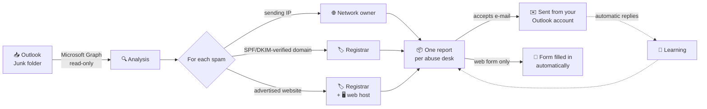
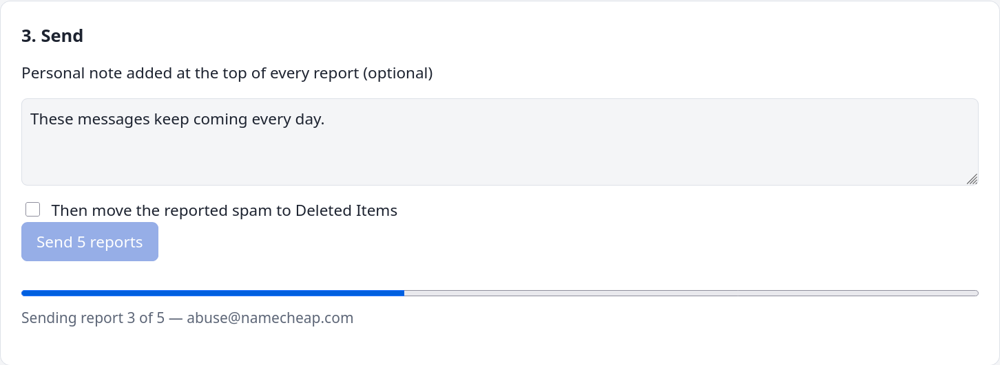
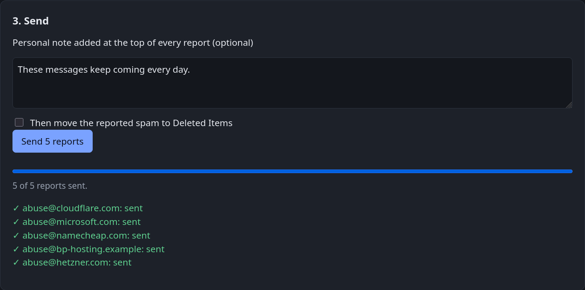

<div align="center">


# Counter-Spam

**Turn your Outlook junk folder into abuse reports that reach the people who can actually stop the spam.**

[](https://github.com/CLeBeRFR/Counter-Spam/releases)
[](https://www.python.org/)
[](#-quick-start)
[](#-development)
[](https://peps.python.org/pep-0008/)
[](LICENSE)

<picture>
  <source media="(prefers-color-scheme: dark)" srcset="docs/images/overview-dark.png">
  
</picture>

</div>

---

## ✨ Why Counter-Spam?

Clicking *"Report junk"* only teaches your own mailbox. The servers sending
the spam, the registrars of the scam domains and the hosts of the phishing
pages keep running. Counter-Spam finds **who is really responsible** for each
spam and sends them **one clear, grouped report** with the evidence they need.

| | |
|---|---|
| 🔐 **Secure Outlook sign-in** | OAuth 2.0 with Microsoft: your password never reaches the program, MFA keeps working, tokens are encrypted by your OS. |
| 🎯 **The right recipients** | Sending servers, authenticated domains and advertised websites are traced through RDAP. Forged headers are never trusted. |
| 📦 **One report per provider** | 50 spams become a handful of reports, each with a summary table and the original `.eml` messages attached. |
| 🧠 **Learns from replies** | Providers that answer *"use our web form"* or bounce are detected automatically and are no longer e-mailed. |
| 📝 **Fills abuse forms for you** | Web forms are opened and filled in automatically. You review, solve the CAPTCHA and submit. |
| 🖥️ **Simple interface** | A local web app in your browser, plus a complete command line. Windows, macOS and Linux. |

## 🧭 How it works



1. **Analyze** the Junk folder. Only information observed by Microsoft (the
   sending IP) or verified by SPF/DKIM is used to find the senders. The
   `From` header, trivially forged, is ignored.
2. **Look up** the abuse contacts through RDAP, the standard successor of
   WHOIS. Only *abuse* contacts are kept: the registrant of a spam domain is
   often the spammer.
3. **Group** everything per abuse desk and **review** it in the interface.
4. **Send** after one confirmation, or **fill in** the web forms of the
   providers that require one.

## 📸 A tour of the interface

<table>
<tr>
<td width="50%" valign="top">

**Review each report before it leaves.** The spams concerning a provider,
the evidence and the exact text of the report.


</td>
<td width="50%" valign="top">

**Send everything with one confirmation**, and follow the progress report by
report.





</td>
</tr>
</table>

**Web forms filled in automatically.** For providers that only accept their
web form, Counter-Spam opens it and fills in every field it recognises
(outlined in green), attaches the messages, and lets you check, solve the
CAPTCHA and submit.

<p align="center">
  
</p>

## 🚀 Quick start

**Requirements:** Python 3.9 or later, an Outlook.com / Hotmail / Live or
Microsoft 365 mailbox. Firefox, Chrome or Edge for the optional form filling.

<details open>
<summary><b>Windows (PowerShell)</b></summary>

```powershell
git clone https://github.com/CLeBeRFR/Counter-Spam.git
cd Counter-Spam
py -m venv .venv
.venv\Scripts\Activate.ps1
pip install ".[autofill]"
counter-spam gui
```
</details>

<details>
<summary><b>macOS</b></summary>

```bash
git clone https://github.com/CLeBeRFR/Counter-Spam.git
cd Counter-Spam
python3 -m venv .venv
source .venv/bin/activate
pip install ".[autofill]"
counter-spam gui
```
</details>

<details>
<summary><b>Linux (Debian / Ubuntu)</b></summary>

The encrypted token cache uses the Secret Service (GNOME Keyring, KWallet):

```bash
sudo apt install python3-gi gir1.2-secret-1
git clone https://github.com/CLeBeRFR/Counter-Spam.git
cd Counter-Spam
python3 -m venv --system-site-packages .venv
source .venv/bin/activate
pip install ".[autofill]"
counter-spam gui
```
</details>

On first launch, your browser opens on the Microsoft sign-in page. Sign in
with your usual account and accept the *read your mail* permission. That's
all: no account to create, nothing to configure. The connection is
remembered, encrypted, until you run `counter-spam logout`.

> [!TIP]
> Without the `[autofill]` extra (`pip install .`), everything works except
> the automatic filling of web forms.

## 🖱️ Everyday use

```bash
counter-spam gui
```

1. **Analyze**: starts on its own. Counter-Spam also reads the replies to
   your previous reports, so it knows which providers want a web form.
2. **Review**: untick a recipient if needed, open *Show the messages and the
   report* to read exactly what will be sent.
3. **Send**: one confirmation, then every e-mail report goes out. A copy is
   kept in your *Sent Items*.
4. **Forms**: on cards marked *Web form only*, click **Fill in the form
   automatically**, check the form in the window that opens, solve the
   CAPTCHA, submit it, then click **Mark as reported**.

Spams already reported to a provider are never offered to it again.

## ⌨️ Command line

Everything is also available without the interface:

<p align="center">
  
</p>

| Command | What it does |
|---|---|
| `counter-spam login` | Sign in (read-only permission) |
| `counter-spam list` | List the Junk folder |
| `counter-spam show 1` | Read a message safely (index or ID) |
| `counter-spam analyze` | Dry run: who would receive which report |
| `counter-spam report` | Send the grouped reports after one confirmation |
| `counter-spam report --delete` | …then move the reported spam to *Deleted Items* |
| `counter-spam gui` | Open the web interface |
| `counter-spam logout` | Forget the cached tokens |

Useful options: `-n/--limit` (default 50), `--no-links` (sending
infrastructure only), `--save-eml DIR`, `report --apwg` (also forward to the
[Anti-Phishing Working Group](https://apwg.org/reportphishing/)),
`report --note TEXT`, `report --yes` (no confirmation, e.g. for a scheduled
task), `-v`/`-vv`. `python -m counter_spam` works too.

## 🛡️ Security and privacy

| Topic | Design |
|---|---|
| **Sign-in** | OAuth 2.0 / OpenID Connect with MSAL, authorization code + PKCE in the browser or device code. Your password is typed on Microsoft's page only. |
| **Secrets** | None. Public client: no client secret, no password stored anywhere. |
| **Permissions** | Least privilege, requested when needed: `Mail.Read` to analyze; `Mail.Send` only when a report is sent; `Mail.ReadWrite` only to move reported spam. |
| **Tokens** | Encrypted by the OS: DPAPI (Windows), Keychain (macOS), libsecret (Linux). Kept in memory only if none is available, never in clear text. |
| **Network** | HTTPS only, TLS verification, timeouts. The access token is only ever sent to `graph.microsoft.com`. |
| **Hostile content** | Spam is shown as sanitised text: no remote content, no scripts, terminal escape sequences removed, links never fetched and defanged in reports. Fuzzed with 30,000 malformed messages. |
| **Web interface** | Listens on `127.0.0.1` only, random per-session token, `Host` check (DNS rebinding), custom header (CSRF), strict Content-Security-Policy. |
| **Replies** | Third-party replies are untrusted: a form link is only kept if it is HTTPS and belongs to the provider's own domain or a recognised abuse platform. |
| **Form filling** | Never submits, never solves CAPTCHAs, never ticks consent boxes, never types into a sign-in page, never overwrites what you typed. |
| **Sending** | One confirmation listing every recipient. Nothing is reported twice to the same desk (local ledger of content hashes). Deletion moves to *Deleted Items* (recoverable). |

## ❓ FAQ

<details>
<summary><b>Why not just use an app password?</b></summary>

Microsoft switched off password (basic) authentication for IMAP/SMTP on
Outlook.com in September 2024, app passwords included. OAuth is also safer:
limited permissions, revocable tokens, MFA preserved.
</details>

<details>
<summary><b>Which data leaves my computer?</b></summary>

The reports themselves (to the abuse desks you confirm), RDAP queries (IP
addresses and registered domains, to the official registries) and DNS
lookups of the advertised registered domains. Nothing else, no telemetry.
</details>

<details>
<summary><b>A provider keeps answering "use our web form"</b></summary>

Counter-Spam reads that automatic reply on the next analysis and switches the
provider to *Web form only*. Known cases (Google Cloud, Dynadot,
PublicDomainRegistry, Worldstream…) are already built in.
</details>

<details>
<summary><b>The form filling stopped on a "Just a moment…" page</b></summary>

That is an anti-bot check. Pass it in the browser window: Counter-Spam waits
up to 10 minutes for the form to appear, then fills it in. Same if the site
asks you to sign in.
</details>

## 🧑‍💻 Development

```bash
pip install -e ".[dev]"
pytest --cov=counter_spam   # 1,400+ tests (incl. fuzzing and a real browser), ~99 % coverage
flake8                      # PEP 8, 79 columns
python docs/make_screenshots.py   # regenerate the README screenshots (demo data)
```

<details>
<summary><b>Project layout</b></summary>

| Module | Role |
|---|---|
| `counter_spam/auth.py` | MSAL sign-in, encrypted token cache, scopes |
| `counter_spam/graph.py` | Microsoft Graph mailbox client |
| `counter_spam/headers.py` | Evidence extraction (headers, links) |
| `counter_spam/rdap.py` | Abuse contact lookup via RDAP |
| `counter_spam/providers.py` | Preferences of known abuse desks |
| `counter_spam/campaign.py` | Reporting strategy, grouping, ledger, sending |
| `counter_spam/report.py` | Grouped abuse report text |
| `counter_spam/feedback.py` | Learning from the abuse desks' replies |
| `counter_spam/autofill.py` | Automatic filling of abuse web forms |
| `counter_spam/webui.py`, `web/` | Local web interface |
| `counter_spam/cli.py` | Command line |
</details>

<details>
<summary><b>Using your own Microsoft Entra application</b></summary>

Counter-Spam ships with its own application ID, so users only have to sign
in. To use your own registration instead, create a free Azure account,
register an application for *Accounts in any organizational directory and
personal Microsoft accounts*, add the *Mobile and desktop* redirect URI
`http://localhost`, enable *Allow public client flows*, then:

```bash
counter-spam configure --client-id <APPLICATION-ID>
```

The `COUNTER_SPAM_CLIENT_ID` and `COUNTER_SPAM_TENANT` environment variables
work too. Never create a client secret: a desktop app cannot keep one.
</details>

## 📄 License

[MIT](LICENSE). Use it responsibly: only report messages you actually
received.
