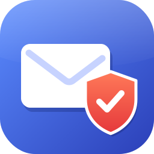
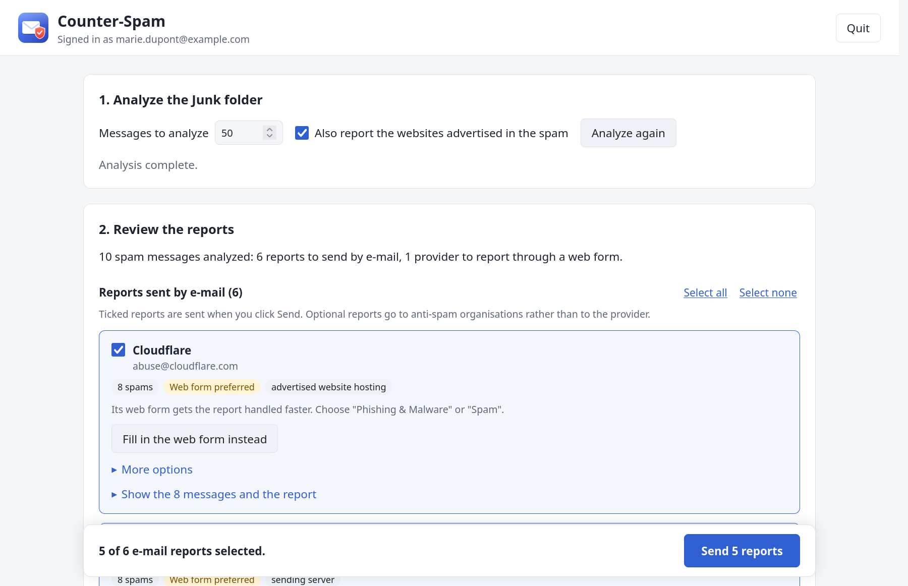
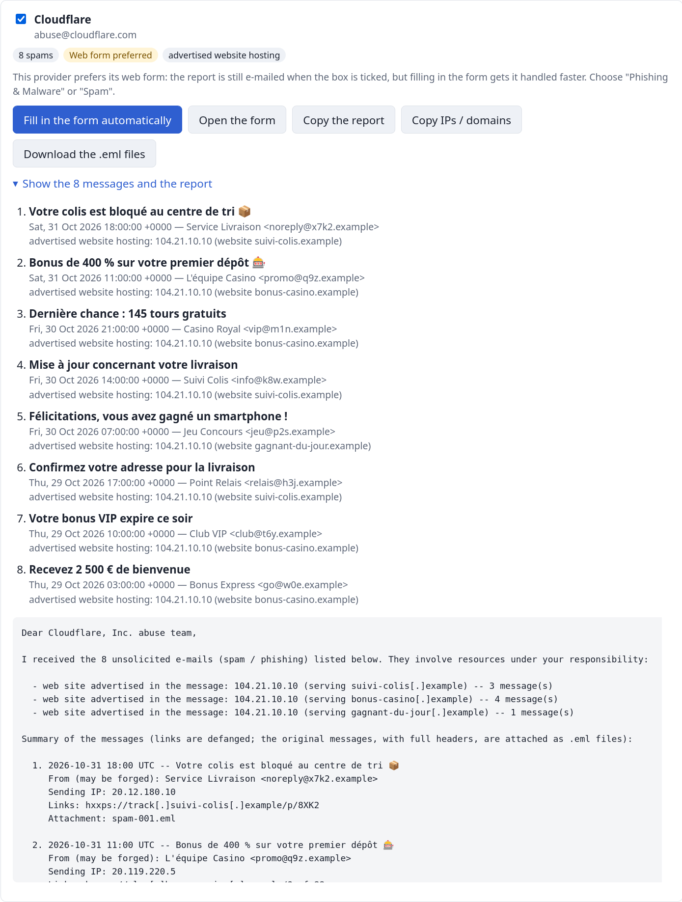
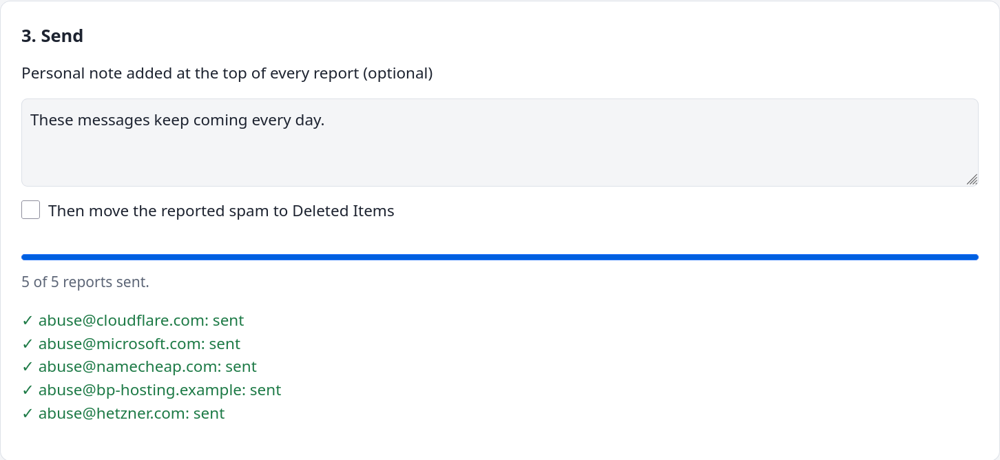
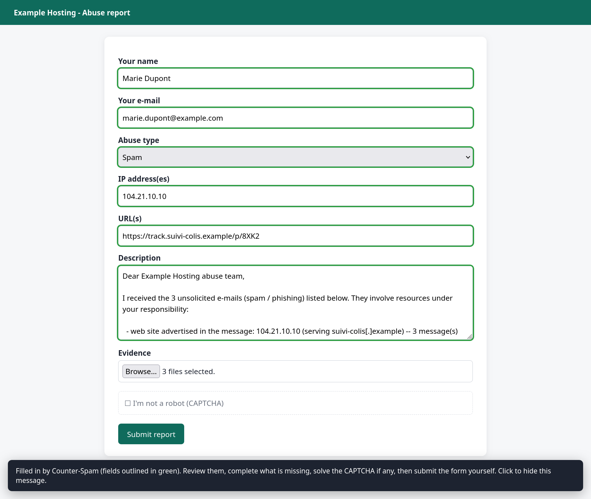
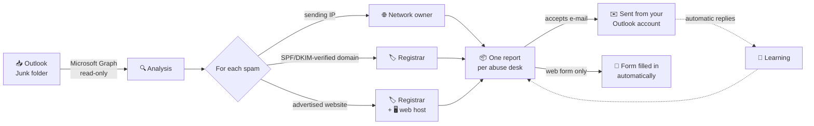
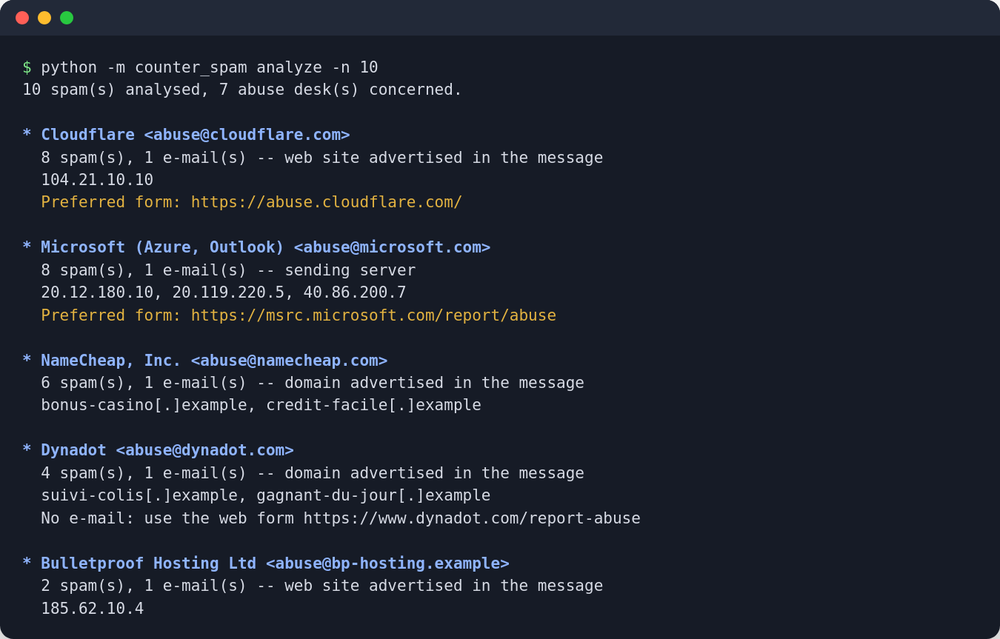

<div align="center">



# Counter-Spam

**Turn your Outlook Junk folder into abuse reports that reach the people who can actually stop the spam.**

[](CHANGELOG.md)
[](https://www.python.org/)
[](#-install)
[](#-development)
[](https://peps.python.org/pep-0008/)
[](LICENSE)

[Install](#-install) ·
[Use it](#%EF%B8%8F-use-it-in-3-steps) ·
[How it works](#-how-it-works) ·
[Command line](#%EF%B8%8F-command-line) ·
[Security](#%EF%B8%8F-security-and-privacy) ·
[FAQ](#-faq)

<picture>
  <source media="(prefers-color-scheme: dark)" srcset="docs/images/overview-dark.png">
  
</picture>

</div>

---

## ✨ Why Counter-Spam?

Clicking *Report junk* only trains your own mailbox. The servers that sent
the spam, the registrars of the scam domains and the hosts of the phishing
pages carry on. Counter-Spam works out **who is really responsible** for each
spam and sends them **one clear, grouped report** with the evidence they
need to act.

| | |
|---|---|
| 🔐 **Secure Outlook sign-in** | OAuth 2.0 with Microsoft: your password never reaches the program, MFA keeps working, tokens are encrypted by your OS. |
| 🎯 **The right recipients** | Sending servers, authenticated domains and advertised websites are traced through RDAP. Forged headers are never trusted. |
| 📦 **One report per provider** | 50 spams become a handful of reports, each with a summary table and the original `.eml` messages attached. |
| 🧠 **Learns from replies** | Providers that answer *"use our web form"* or bounce are detected and no longer e-mailed. |
| 📝 **Fills abuse forms for you** | Web forms are opened and filled in automatically. You check, solve the CAPTCHA and submit. |
| 🖥️ **Simple to use** | A local web app in your browser, three steps, one confirmation. A complete command line too. |

## 🚀 Install

**You need** Python 3.9 or later and an Outlook.com / Hotmail / Live or
Microsoft 365 mailbox. Firefox, Chrome or Edge is only needed for the
optional form filling.

<details open>
<summary><b>Windows (PowerShell)</b></summary>

```powershell
git clone https://github.com/CLeBeRFR/Counter-Spam.git
cd Counter-Spam
py -m venv .venv
.venv\Scripts\Activate.ps1
pip install ".[autofill]"
counter-spam gui
```
</details>

<details>
<summary><b>macOS</b></summary>

```bash
git clone https://github.com/CLeBeRFR/Counter-Spam.git
cd Counter-Spam
python3 -m venv .venv
source .venv/bin/activate
pip install ".[autofill]"
counter-spam gui
```
</details>

<details>
<summary><b>Linux (Debian / Ubuntu)</b></summary>

The encrypted token cache uses the Secret Service (GNOME Keyring, KWallet):

```bash
sudo apt install python3-gi gir1.2-secret-1
git clone https://github.com/CLeBeRFR/Counter-Spam.git
cd Counter-Spam
python3 -m venv --system-site-packages .venv
source .venv/bin/activate
pip install ".[autofill]"
counter-spam gui
```
</details>

**First launch:** your browser opens on the Microsoft sign-in page. Sign in
with your usual account and accept the *read your mail* permission. That's
all: no account to create, nothing to configure. The sign-in is remembered,
encrypted, until you run `counter-spam logout`.

> [!TIP]
> Installed without the `[autofill]` extra (`pip install .`), everything
> works except the automatic filling of web forms.

## 🖱️ Use it in 3 steps

```bash
counter-spam gui
```

### 1. Analyze

The analysis of your Junk folder starts on its own (50 messages by default).
Counter-Spam also reads the replies to your previous reports, so it already
knows which providers want a web form or whose address bounces.

### 2. Review

The reports are split into two lists:

- **Reports sent by e-mail**: ticked by default. Untick a provider to leave
  it out, or use *Select all* / *Select none*. Optional reports (anti-spam
  organisations such as the APWG) start unticked.
- **Reports through a web form**: providers that refuse e-mail. They are
  never part of the sending.

Open *Show the messages and the report* on any card to read the spams
concerned, the evidence found and the exact text that will be sent.

<picture>
  <source media="(prefers-color-scheme: dark)" srcset="docs/images/report-dark.png">
  
</picture>

### 3. Send

The **send bar** stays at the bottom of the window and shows how many
reports are selected. Add a personal note if you like, then click
**Send**: one confirmation lists every recipient, and the progress is shown
report by report. A copy of each report is kept in your *Sent Items*.

<picture>
  <source media="(prefers-color-scheme: dark)" srcset="docs/images/send-dark.png">
  
</picture>

Sent reports are marked **Sent** and locked: they cannot go out twice, now
or in a later analysis.

### Web forms

On a card marked *Web form only*, click **Fill in the form automatically**.
The form opens in a new browser window with every recognised field filled in
(outlined in green) and the messages attached. Check it, solve the CAPTCHA,
submit it, then click **Mark as reported** so these spams are not offered
again.

<p align="center">
  
</p>

Some providers accept e-mail but *prefer* their form. Their card offers
**Fill in the web form instead**, which unticks the e-mail report so the
provider is not reported twice. The other tools (open the form yourself,
copy the report or the IPs and domains, download the `.eml` files) are under
**More options**.

## 🧭 How it works



1. **Collect the evidence.** Only what Microsoft observed (the sending IP)
   or what SPF/DKIM verified is used to find the senders. The `From`
   header, trivially forged, is ignored.
2. **Find the abuse contacts** through RDAP, the standard successor of
   WHOIS. Only *abuse* contacts are kept: the registrant of a spam domain is
   often the spammer.
3. **Group** the findings per abuse desk: one report each, split into
   several e-mails only when the attachments are too large.
4. **Send** from your own Outlook account, or **fill in** the web form of
   the providers that require one.
5. **Learn** from the automatic replies: a provider that asks for its form
   or whose address bounces is switched to *Web form only*.

| What is found in the spam | Who receives the report |
|---|---|
| Sending server (IP seen by Microsoft) | Owner of the network |
| Sending domain authenticated by SPF/DKIM | Registrar of the domain |
| Website advertised in the message | Registrar of the domain and host of the website |

## ⌨️ Command line

Everything is also available without the interface:

<p align="center">
  
</p>

| Command | What it does |
|---|---|
| `counter-spam gui` | Open the web interface |
| `counter-spam analyze` | Dry run: who would receive which report |
| `counter-spam report` | Send the grouped reports after one confirmation |
| `counter-spam list` | List the Junk folder |
| `counter-spam show 1` | Read a message safely (index or ID) |
| `counter-spam login` / `logout` | Sign in / forget the cached tokens |
| `counter-spam whoami` | Show the signed-in account |
| `counter-spam configure` | Use your own Entra application ([see below](#-development)) |

<details>
<summary><b>Options</b></summary>

| Option | Commands | Effect |
|---|---|---|
| `-n`, `--limit N` | `analyze`, `report` | Messages to analyze (default 50) |
| `--no-links` | `analyze`, `report` | Sending infrastructure only, not the advertised websites |
| `--save-eml DIR` | `analyze`, `report` | Also save each message as an `.eml` file |
| `--delete` | `report` | Then move the reported spam to *Deleted Items* |
| `--apwg` | `report` | Also forward to the [Anti-Phishing Working Group](https://apwg.org/reportphishing/) |
| `--note TEXT` | `report` | Personal note added at the top of every report |
| `-y`, `--yes` | `report` | No confirmation (e.g. for a scheduled task) |
| `--port N`, `--no-browser` | `gui` | Fixed local port / only print the address to open |
| `--auth-method` | all | `browser`, `device` (code to type on another device) or `auto` |
| `-v`, `-vv` | all | More details |

`python -m counter_spam` works too.
</details>

## 🛡️ Security and privacy

| Topic | Design |
|---|---|
| **Sign-in** | OAuth 2.0 / OpenID Connect with MSAL, authorization code + PKCE in the browser, or device code. Your password is typed on Microsoft's page only. |
| **Secrets** | None. Public client: no client secret, no password stored anywhere. |
| **Permissions** | Least privilege, requested when needed: `Mail.Read` to analyze, `Mail.Send` only when a report is sent, `Mail.ReadWrite` only to move reported spam. |
| **Tokens** | Encrypted by the OS: DPAPI (Windows), Keychain (macOS), libsecret (Linux). Kept in memory only if none is available, never in clear text. |
| **Network** | HTTPS only, TLS verification, timeouts. The access token is only ever sent to `graph.microsoft.com`. |
| **Hostile content** | Spam is shown as sanitised text: no remote content, no scripts, terminal escape sequences removed, links never fetched and defanged in reports. Fuzzed with 30,000 malformed messages. |
| **Web interface** | Listens on `127.0.0.1` only, random per-session token, `Host` check (DNS rebinding), custom header (CSRF), strict Content-Security-Policy, no HTML ever built from spam data. |
| **Replies** | Third-party replies are untrusted: a form link is only kept if it is HTTPS and belongs to the provider's own domain or a recognised abuse platform. |
| **Form filling** | Never submits, never solves CAPTCHAs, never ticks consent boxes, never types into a sign-in page, never overwrites what you typed. |
| **Sending** | One confirmation listing every recipient. Nothing is reported twice to the same desk (local ledger of content hashes). Deletion moves to *Deleted Items*, which is recoverable. |

## ❓ FAQ

<details>
<summary><b>Why not just use an app password?</b></summary>

Microsoft switched off password (basic) authentication for IMAP/SMTP on
Outlook.com in September 2024, app passwords included. OAuth is also safer:
limited permissions, revocable tokens, MFA preserved.
</details>

<details>
<summary><b>Which data leaves my computer?</b></summary>

The reports themselves (to the abuse desks you confirm), RDAP queries (IP
addresses and registered domains, to the official registries) and DNS
lookups of the advertised registered domains. Nothing else, no telemetry.
</details>

<details>
<summary><b>Can a provider receive the same spam twice?</b></summary>

No. Every report sent, and every provider you mark as reported, is recorded
in a local ledger: these spams are no longer offered to that provider, even
in a later analysis.
</details>

<details>
<summary><b>A provider keeps answering "use our web form"</b></summary>

Counter-Spam reads that automatic reply on the next analysis and switches the
provider to *Web form only*. Known cases (Microsoft, Cloudflare, Google
Cloud, Dynadot, PublicDomainRegistry, Worldstream) are built in.
</details>

<details>
<summary><b>The form filling stopped on a "Just a moment…" page</b></summary>

That is an anti-bot check. Pass it in the browser window: Counter-Spam waits
up to 10 minutes for the form to appear, then fills it in. Same if the site
asks you to sign in.
</details>

<details>
<summary><b>How do I stop the interface?</b></summary>

Click **Quit** at the top right, or press <kbd>Ctrl</kbd>+<kbd>C</kbd> in the
terminal. Nothing is lost: what was sent is in the ledger and in your
*Sent Items*.
</details>

## 🧑‍💻 Development

```bash
pip install -e ".[dev]"
pytest --cov=counter_spam          # 1,400+ tests (incl. fuzzing and a real browser), ~99 % coverage
flake8                             # PEP 8, 79 columns
python docs/make_screenshots.py    # regenerate the screenshots from demo data
```

<details>
<summary><b>Project layout</b></summary>

| Module | Role |
|---|---|
| `counter_spam/auth.py` | MSAL sign-in, encrypted token cache, scopes |
| `counter_spam/graph.py` | Microsoft Graph mailbox client |
| `counter_spam/headers.py` | Evidence extraction (headers, links) |
| `counter_spam/rdap.py` | Abuse contact lookup via RDAP |
| `counter_spam/providers.py` | Preferences of known abuse desks |
| `counter_spam/campaign.py` | Reporting strategy, grouping, ledger, sending |
| `counter_spam/report.py` | Grouped abuse report text |
| `counter_spam/feedback.py` | Learning from the abuse desks' replies |
| `counter_spam/autofill.py` | Automatic filling of abuse web forms |
| `counter_spam/webui.py`, `web/` | Local web interface |
| `counter_spam/cli.py` | Command line |
</details>

<details>
<summary><b>Using your own Microsoft Entra application</b></summary>

Counter-Spam ships with its own application ID, so users only have to sign
in. To use your own registration instead, create a free Azure account,
register an application for *Accounts in any organizational directory and
personal Microsoft accounts*, add the *Mobile and desktop* redirect URI
`http://localhost`, enable *Allow public client flows*, then:

```bash
counter-spam configure --client-id <APPLICATION-ID>
```

The `COUNTER_SPAM_CLIENT_ID` and `COUNTER_SPAM_TENANT` environment variables
work too. Never create a client secret: a desktop app cannot keep one.
</details>

## 📄 License and changes

[MIT](LICENSE). Use it responsibly: only report messages you actually
received. What changed in each version is in the [changelog](CHANGELOG.md).
